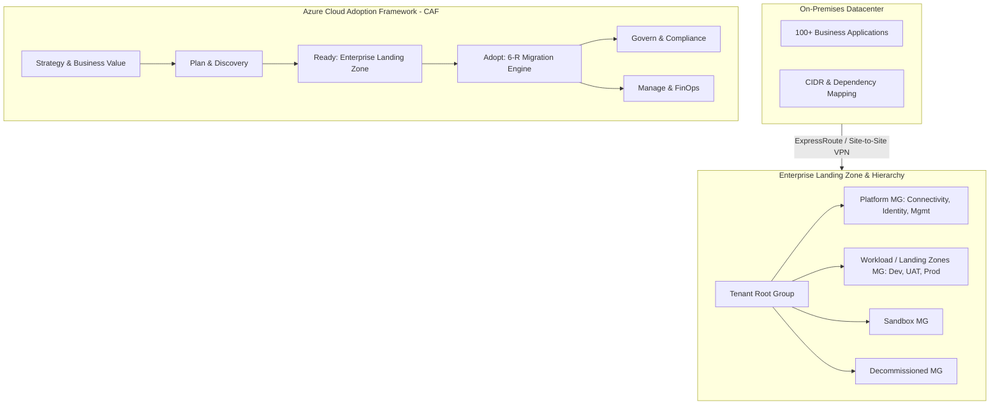

<div align="center">

# ☁️ Pankaj Singh
### **Enterprise Cloud Architect | Principal DevSecOps & Cloud Migration Lead**
#### *Bridging Business Strategy with Resilient, Secure & Cost-Optimized Cloud Engineering*

[](#)
[](https://linkedin.com/in/)
[](#)
[](https://github.com/pankajec68-png)
[](#)

---

```text
🚀 Specializing in: Azure CAF Landing Zones | 100+ App Migrations | DevSecOps Pipelines | FinOps | Zero Trust Security
```

</div>

---

## 👨‍💼 Executive Summary & Leadership Profile

Seasoned **Enterprise Cloud Architect and Technical Lead** with comprehensive techno-functional mastery across the entire cloud adoption and delivery lifecycle. Adept at translating high-level business drivers into scalable, secure, and resilient multi-cloud architectures. 

Extensive experience spanning **PreSales, Technical Account Management (TAM), Solution Architecture, and Hands-on Engineering Leadership**, driving digital transformations, multi-subscription Azure Landing Zones, and large-scale enterprise migrations (100+ workloads).

```
   ┌────────────────────────────────────────────────────────────────────────────────────────┐
   │                               TECHNO-FUNCTIONAL SPECTRUM                               │
   ├───────────────┬─────────────────┬─────────────────┬──────────────────┬─────────────────┤
   │     Sales     │    PreSales     │       TAM       │ Enterprise Arch  │  Technical Lead │
   │  Opportunity  │ Techno-Function │ Account Success │ Infra + Apps     │ Hands-on Infra  │
   │  & Strategy   │ POCs & RFPs     │ & Governance    │ Strategy & CAF   │ & Code Delivery │
   └───────────────┴─────────────────┴─────────────────┴──────────────────┴─────────────────┘
```

---

## 🛠️ Technology Stack & Core Competencies

<div align="center">

| Domain | Technologies & Frameworks |
| :--- | :--- |
| **Cloud Platforms** |    |
| **Infrastructure as Code** |    |
| **CI/CD & DevSecOps** |     |
| **Security & Governance** |     |
| **Networking** |     |
| **FinOps & Observability** |     |
| **Containers & Scripting** |      |

</div>

---

## 🏛️ Featured Enterprise Scenario: 100+ Workload Migration & Landing Zone

> **Mission**: End-to-end migration of **100+ distributed business applications** across **Dev, UAT, and Production** environments from on-premises datacenters to a robust Microsoft Azure foundation.



### 🎯 Key Architectural Pillars Achieved
* **Scalable & Portable**: Modular infrastructure codified via reusable Terraform modules.
* **Governed & Secure**: Zero Trust principles, Azure Policy guardrails, Entra ID PIM, and Defender for Cloud.
* **Highly Available & Resilient**: Zone-redundancy (ZRS), Geo-replication (GRS), VMSS, and clear RTO/RPO targets.
* **Cost-Optimized (FinOps)**: Idle resource harvesting, VM auto start/stop, unattached disk removal, and Reserved Instances.
* **Observability First**: Centralized Log Analytics, Azure Monitor metrics, and proactive alerting.

---

## 📐 Deep-Dive Architecture & Engineering Pillars

<details open>
<summary><h3>1. 🏢 Enterprise Governance, Identity & Management Hierarchy</h3></summary>

* **Cloud Adoption Framework (CAF)**: Structured execution across the 6 core dimensions:
  * **Plan**: Technical assessment, workload prioritization, skill readiness.
  * **Ready**: Enterprise-scale Landing Zone implementation.
  * **Adopt**: Phased migration waves with automated validation.
  * **Govern**: Policy enforcement, cost guardrails, regulatory compliance.
  * **Secure**: Identity federation, centralized perimeter, threat detection.
  * **Manage**: SRE operations, patch management, business continuity.
* **Tenant & Management Group Hierarchy**:
  * Root tenant group partitioning: `Platform MG`, `Landing Zones (Workloads) MG`, `Sandbox MG`, and `Decommissioned MG`.
  * Dedicated subscription segregation: Platform subscriptions (Connectivity, Identity, Management) vs. Application workloads (`Dev`, `UAT`, `Prod`).
* **Identity & Access Management (Microsoft Entra ID)**:
  * Fine-grained Role-Based Access Control (RBAC) groups aligned with least privilege.
  * Privileged Identity Management (PIM) with just-in-time access and multi-stage approvals.
  * Standardized subscription onboarding/offboarding workflows with strict justification policies.
* **Policy-Driven Governance**:
  * Azure Policy and Initiative assignments enforced at Management Group roots.
  * Documented policy exemptions with security board justifications and expiration dates.
</details>

<details open>
<summary><h3>2. 🌐 Hub & Spoke Networking Architecture</h3></summary>

* **IP Address Management (IPAM) & CIDR Assessment**:
  * Discovery and assessment of on-premises subnets to eliminate CIDR overlap.
  * Future-proof non-overlapping IP allocation across multiple regions and landing zones.
* **HUB-and-Spoke Topology**:
  * **HUB VNet**: Centralized shared services, Azure Firewall, VPN Gateway, and ExpressRoute circuits.
  * **Spoke VNets**: Workload-specific subnets connected via bidirectional VNet Peering with Gateway Transit enabled.
* **Traffic Inspection & Routing**:
  * User-Defined Routes (UDR) forcing all inter-spoke and egress traffic through the centralized Azure Firewall.
  * Controlled internet egress preventing data exfiltration.
* **Private Connectivity & Name Resolution**:
  * Centralized Private DNS Zones linked across all spoke VNets.
  * Private Endpoints for PaaS services (Azure SQL, Storage, Key Vault, Container Registry) eliminating public IPs.
</details>

<details open>
<summary><h3>3. 🛡️ Multi-Tier Security (Defense-in-Depth)</h3></summary>

```
  ┌────────────────────────────────────────────────────────────────────────┐
  │ 1. Identity Level   : Entra ID, MFA, Conditional Access, PIM, RBAC     │
  ├────────────────────────────────────────────────────────────────────────┤
  │ 2. Network Level    : Hub Firewall, NSG/ASG micro-segmentation, PE     │
  ├────────────────────────────────────────────────────────────────────────┤
  │ 3. Compute Level    : CIS-hardened VM images, VMSS, disk encryption    │
  ├────────────────────────────────────────────────────────────────────────┤
  │ 4. Governance Level : Defender for Cloud, Azure Policies, Sentinel     │
  └────────────────────────────────────────────────────────────────────────┘
```

* **Identity Layer**: Strict Conditional Access, MFA enforcement, and elimination of persistent administrator privileges.
* **Network Layer**: Layer 4/7 inspection, Application Security Groups (ASG), Network Security Groups (NSG), and DDoS Protection.
* **Compute Layer**: Hardened base images, automated patch baseline via Azure Update Manager, Azure Disk Encryption (ADE/CMEK).
* **Data Layer**: Encryption-in-transit (TLS 1.3) and encryption-at-rest with customer-managed keys (CMK) in Azure Key Vault with soft-delete and purge protection.
</details>

<details open>
<summary><h3>4. ⚡ Terraform Landing Zone Automation & IaC Best Practices</h3></summary>

* **State Management**:
  * Remote state stored in georedundant Azure Blob Storage with state leasing/locking.
  * Strict RBAC: Least privileges access to state files (preventing credential leakage).
  * Storage-level encryption-at-rest with customer-managed keys.
* **Modular Codebase**:
  * Highly reusable, version-pinned modules for networking, compute, identity, and governance.
  * Adherence to standard folder layouts (environments, modules, live configurations).
* **Automated CI/CD Quality Gates**:
  * Static code analysis and linting via `tflint` and `terraform fmt`.
  * Automated secret scanning with `TruffleHog` / `GitLeaks`.
  * Cost estimation shift-left using `Infracost` directly on pull requests.
  * Multi-stage approvals before `terraform apply` on Production workspaces.
* **Drift Detection**:
  * Scheduled pipeline jobs executing `terraform plan -detailed-exitcode` to detect and alert on unauthorized manual configuration changes.
</details>

<details open>
<summary><h3>5. 🚀 Azure DevOps & DevSecOps Engineering</h3></summary>

* **Branching Strategy & Governance**:
  * Strict **Trunk-Based Branching** with short-lived feature branches.
  * Branch Policies enforced on `main`:
    * No direct commits or deletion allowed.
    * Mandatory Pull Requests (PR) with designated **Code Owners** sign-off.
    * Required minimum reviewers and passing CI status checks before merge.
* **Modular Pipeline Architecture**:
  * Reusable YAML pipeline templates covering:
    1. `Validate & Test`: Syntax validation, unit testing, security scanning.
    2. `Build & Package`: Artifact generation, container image builds.
    3. `Deployment`: Staged rollout across Dev -> UAT -> Prod.
    4. `Apply & Verification`: Post-deployment smoke tests.
    5. `Automated Rollback`: Fast rollback mechanism on failure detection.
* **High-Throughput Execution**:
  * Parallel job runners and self-hosted agent pools for compute-heavy builds.
* **Bootstrap Automation**:
  * Middleware and dependency configuration bootstrapped via Custom Script Extensions and `cloud-init / custom_data` scripts.
</details>

<details open>
<summary><h3>6. 🔄 Cloud Migration Factory (100+ Applications)</h3></summary>

* **Strategic Framework (6 R's)**: Rehost (Lift & Shift), Replatform, Refactor, Repurchase, Retain, Retire.
* **End-to-End Migration Lifecycle**:
  ```
  [Discovery & Assessment] ──> [Wave Planning] ──> [Pre-Migration Checklist]
                                                           │
  [Hypercare & Handover]   <── [Cutover Window]  <── [Migration Execution]
  ```
* **Comprehensive Checklists**:
  * **Pre-Migration**: Dependency mapping, network latency testing, firewall whitelist verification, backup validation, stakeholder signoff.
  * **During Migration**: Data synchronization, DNS TTL reduction, cutover execution, health check verification.
  * **Post-Migration**: Performance baseline comparison, telemetry validation, backup schedule activation.
* **Cutover & Hypercare**: Dedicated 24/7 command center and hypercare monitoring period for zero business disruption.
</details>

<details open>
<summary><h3>7. 💰 FinOps & Cloud Cost Optimization</h3></summary>

* **Waste Elimination**:
  * Automated discovery and removal of orphaned / unattached managed disks.
  * Decommissioning idle public IPs, unused load balancers, and orphaned NICs.
  * Rightsizing oversized compute instances based on 30-day CPU/Memory P95 utilization metrics.
* **Log Ingestion & Storage Optimization**:
  * Pruning high-volume, low-value table ingestions in Log Analytics Workspaces.
  * Optimizing retention windows (e.g., 30 days hot, moving archive to Azure Data Lake / Blob Cold tiers).
* **Scheduling & Commitments**:
  * Automated Start/Stop automation for non-production VMs (Dev/UAT) outside business hours (saving up to 65% compute cost).
  * 1-year and 3-year Azure Reserved Virtual Machine Instances (RI) and Azure Savings Plans portfolio management.
</details>

<details open>
<summary><h3>8. 🔁 Backup, Disaster Recovery (BCDR) & High Availability</h3></summary>

* **Storage Resiliency**:
  * Locally Redundant Storage (LRS) for scratch/ephemeral workloads.
  * Zone-Redundant Storage (ZRS) for mission-critical intra-region high availability.
  * Geo-Redundant Storage (GRS / RA-GRS) for disaster recovery compliance.
* **Compute High Availability**:
  * Virtual Machine Scale Sets (VMSS) across multiple Azure Availability Zones (99.99% SLA).
* **Disaster Recovery SLA**:
  * Defined, tested **RTO** (Recovery Time Objective) and **RPO** (Recovery Point Objective) per workload tier.
  * Automated Azure Site Recovery (ASR) replication between Primary and Secondary paired regions with scheduled failover drills.
</details>

<details open>
<summary><h3>9. 📊 Monitoring, Telemetry & Observability</h3></summary>

* **Azure Monitor & Log Analytics**:
  * Centralized workspace design collecting diagnostics across all subscriptions and tenant resources.
* **Application Insights**:
  * Distributed tracing, exception tracking, dependency failure analysis, and live performance metrics.
* **Proactive Alerting & Dashboards**:
  * Action Groups integrated with PagerDuty / Microsoft Teams for real-time alerting.
  * Executive and operational dashboards tracking SLA, budget burn rate, and latency.
</details>

<details open>
<summary><h3>10. 👔 Vendor, Program & Engineering Leadership</h3></summary>

* **Presales, RFP/RFI & Commercials**:
  * Drafting and evaluating Requests for Proposals (RFP) and Requests for Information (RFI).
  * Developing Technical Evaluation Matrices, architectural capability scoring, and commercial effort estimation.
* **Vendor & Contract Governance**:
  * Clear Scope of Work (SOW), Deliverables, Acceptance Criteria, Sprint cadence, and Dependency management.
  * Payment milestone signoffs tied to verified engineering deliverables.
  * Designing clear Technical Escalation Matrices and enforcing least-privilege vendor access.
* **Transitions, Mentorship & Upskilling**:
  * Structuring Documentation Handovers and RACI matrices (Responsible, Accountable, Consulted, Informed).
  * Conducting knowledge transfer (KT) sessions, SOP creation, and senior-level interview panels.
  * Fostering a continuous learning culture and upskilling teams in Terraform, DevSecOps, and Cloud Architecture.
</details>

---

## 📈 GitHub Activity & Engineering Stats

<div align="center">


<br/>

[](https://git.io/streak-stats)

</div>

---

## 📬 Connect & Collaborate

I am open to discussions on **Enterprise Cloud Architecture, Cloud Migrations, DevSecOps Strategy, and FinOps Consultations**.

| Platform | Direct Link | Purpose |
| :--- | :--- | :--- |
| 📄 **Resume / CV** | [Download Resume](#) | Full Career History & Technical Milestones |
| 💼 **LinkedIn** | [linkedin.com/in/...](https://linkedin.com/in/) | Professional Network & Recommendations |
| 🌐 **Naukri.com** | [Naukri Profile](#) | Indian Enterprise Job Market & Opportunities |
| 🐙 **GitHub** | [@pankajec68-png](https://github.com/pankajec68-png) | Code, Terraform Modules, CI/CD Blueprints |
| 🌍 **Portfolio Website** | [Visit Portfolio](#) | Case Studies, Technical Blogs & Architecture Blueprints |
| 📧 **Direct Email** | [pankajec68@gmail.com](mailto:pankajec68@gmail.com) | Direct Consultations & Executive Inquiries |

* 📍 **Focus Areas**: Enterprise Azure Architecture, Cloud Landing Zones (CAF), Terraform IaC, DevSecOps Leadership, 100+ Workload Migrations

<div align="center">
  <sub>Crafted with passion for engineering excellence and scalable cloud systems.</sub>
</div>
