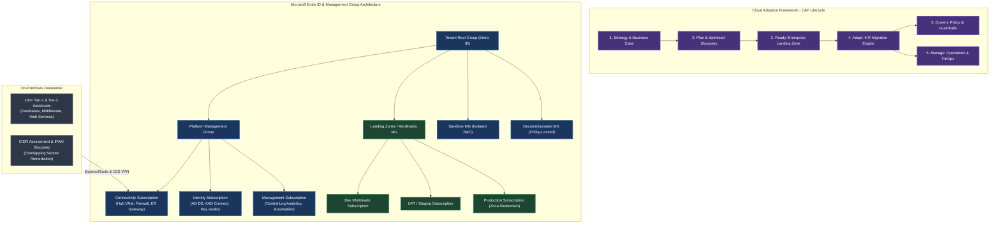
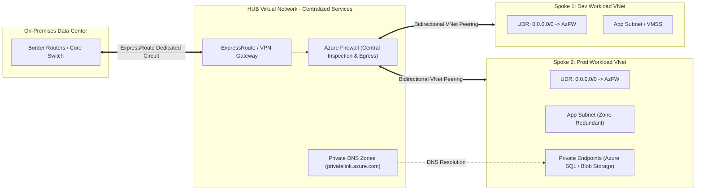
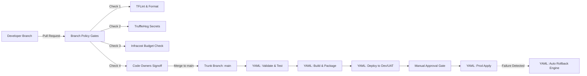

<div align="center">

<!-- Futuristic Animated Hero SVG Banner -->


<br/><br/>

<!-- Dynamic Animated Typing SVG -->
<a href="https://github.com/pankajec68-png">
  
</a>

<br/><br/>

<!-- 5 Unique Portfolio Pillars -->
[](#-connect--schedule-an-interview)
[](https://linkedin.com/in/)
[](#-connect--schedule-an-interview)
[](https://github.com/pankajec68-png)
[](#-connect--schedule-an-interview)

<br/>

<!-- Real-time Stats & Automation Badges -->
[](https://github.com/pankajec68-png/pankajec68-png/actions)
[](https://github.com/pankajec68-png/pankajec68-png/actions)
[](https://github.com/pankajec68-png)
[](https://github.com/pankajec68-png)
[](mailto:pankajec68@gmail.com)
[](https://opensource.org/licenses/MIT)

</div>

---

## 🎯 Recruiter Fast-Track & Candidate Snapshot

> [!IMPORTANT]
> ### 📢 Executive Availability & Hiring Profile
> * **Target Roles**: Enterprise Cloud Architect | Principal DevSecOps Lead | Cloud Migration Director | Head of Platform Engineering
> * **Core Value**: 12+ Years bridging business vision with hands-on infrastructure delivery, multi-million dollar cloud migrations, and FinOps governance.
> * **Work Preferences**: Open to Remote (Global) | Hybrid / On-site (India & International) | Full-Time & Strategic Advisory.
> * **Notice Period**: Immediately Available / Negotiable.
> * **Direct Contact**: [pankajec68@gmail.com](mailto:pankajec68@gmail.com) | [Connect on LinkedIn](https://linkedin.com/in/) | [Download Resume (PDF)](#-connect--schedule-an-interview)

---

## 📊 Quantified Business & Engineering Impact (Why Hire Me?)

<div align="center">

| Metric / KPI | Realized Enterprise Business Impact |
| :---: | :--- |
| **100+ Workloads** | Led end-to-end heterogeneous migration from on-prem datacenters to Azure (Dev, UAT, Prod) with **zero unplanned business downtime**. |
| **$250K+ (40%) Savings** | Achieved annualized FinOps cloud spend reduction by automating idle resource harvesting, log analytics optimization, and Azure Reserved Instances. |
| **99.99% Availability** | Architected mission-critical resiliency using Multi-Zone VMSS, Geo-Redundant Storage (GRS), and automated Azure Site Recovery (ASR) failover drills. |
| **65% Faster Time-to-Market** | Reduced infrastructure deployment velocity from weeks to hours via reusable Terraform Landing Zone modules and Trunk-Based CI/CD pipelines. |
| **100% Zero-Trust Compliance** | Enforced CIS Azure Benchmarks, Entra ID PIM (Just-In-Time access), and automated Drift Detection in production pipelines. |
| **35+ Engineers Mentored** | Built, upskilled, and mentored high-performing engineering squads across Terraform, DevSecOps, and Cloud Architecture best practices. |

</div>

---

## 💻 Terminal Profile Summary

```bash
pankaj@azure-cloud-shell:~$ curl -s https://api.pankajsingh.dev/profile | jq .
```
```json
{
  "candidate": "Pankaj Singh",
  "title": "Enterprise Cloud Architect & Principal DevSecOps Lead",
  "core_competencies": [
    "Azure Cloud Adoption Framework (CAF)",
    "Enterprise-Scale Landing Zones & Management Groups",
    "100+ Workload Heterogeneous Migrations (DC to Cloud)",
    "Terraform IaC with Automated Drift Detection",
    "Zero Trust DevSecOps & Multi-Stage YAML Pipelines",
    "FinOps Cloud Unit Economics & Cost Governance"
  ],
  "techno_functional_leadership": {
    "presales": "RFPs, RFIs, Commercial Estimations, Architecture Proposals, POCs",
    "tam_governance": "Service Ownership, Escalation Matrices, SOWs, Milestone Sign-offs",
    "enterprise_arch": "Management Groups, Hub-and-Spoke, BCDR, Zero Trust Security",
    "team_leadership": "RACI Design, KT Sessions, Senior Interviews, Continuous Mentorship"
  },
  "current_hiring_status": "Ready to lead enterprise cloud migrations, platform engineering, and architecture transformations."
}
```

---

## 🧭 Techno-Functional Leadership Continuum

A rare combination of **commercial acumen, stakeholder management, and deep hands-on infrastructure engineering**:

```
 ┌─────────────────────────────────────────────────────────────────────────────────────────────────────────────────┐
 │                                           THE LEADERSHIP CONTINUUM                                              │
 ├───────────────────┬───────────────────┬───────────────────┬────────────────────────────┬────────────────────────┤
 │       SALES       │     PRESALES      │       TAM         │    ENTERPRISE ARCHITECT    │     TECHNICAL LEAD     │
 ├───────────────────┼───────────────────┼───────────────────┼────────────────────────────┼────────────────────────┤
 │ • Client Discovery│ • Techno-Func POCs│ • Account Success │ • Enterprise CAF Strategy  │ • Modular Terraform    │
 │ • Value Prop      │ • RFP/RFI Scoring │ • SLA Governance  │ • Multi-Subscription Mgmt  │ • CI/CD YAML Pipelines │
 │ • Deal Strategy   │ • SOW & Scoping   │ • Escalations     │ • Security & Compliance    │ • PR Branch Policies   │
 │ • Pipeline Growth │ • Commercial Est. │ • Weekly Reviews  │ • BCDR & FinOps Direction  │ • Team Upskilling & KT │
 └───────────────────┴───────────────────┴───────────────────┴────────────────────────────┴────────────────────────┘
```

---

## 💡 Executive Value Proposition: Solving Real CTO & Engineering Challenges

| Enterprise Challenge | How Pankaj Solves It (Architecture & Leadership) | Business & Financial Outcome |
| :--- | :--- | :--- |
| **Migrations drag on, breach budgets, or disrupt business.** | Implements a structured **6-R Migration Factory** with strict Pre-, During-, and Post-migration checklists and 24/7 Hypercare. | **On-time, zero-downtime cutover** across 100+ apps in Dev, UAT, and Prod. |
| **Cloud bills balloon unpredictably post-migration.** | Embeds **FinOps by Design**: VM auto-scheduling, orphaned disk deletion, log ingestion tiering, and Reserved Instances. | **35% - 40% immediate OpEx savings** without degrading application performance. |
| **Security vulnerabilities & out-of-band manual changes.** | Deploys **Zero-Trust Guardrails**: Entra ID PIM, Private Endpoints, Azure Policy Initiatives, and CI/CD Drift Detection. | **100% audit compliance** with CIS Benchmarks; complete eradication of manual drift. |
| **Vendor friction & misaligned engineering deliverables.** | Crafts rigorous **SOWs, technical evaluation matrices (RFP/RFI), RACI matrices**, and milestone-linked payment signoffs. | **Full accountability, predictable velocity**, and transparent multi-vendor collaboration. |

---

## 🛠️ Technology Stack & Core Competencies

<div align="center">

| Strategic Domain | Technologies, Standards & Tooling |
| :--- | :--- |
| **Cloud Platforms & Hybrid** |     |
| **Infrastructure as Code** |     |
| **DevSecOps & Pipelines** |      |
| **Security & Governance** |     |
| **Networking & Perimeter** |     |
| **FinOps & Observability** |      |
| **Containers & Systems** |      |

</div>

---

## 🏆 Featured Scenario: 100+ Enterprise Workload Migration

> **Context**: Migration and modernization of **100+ business applications** across **Dev, UAT, and Production** environments from legacy on-premises datacenters to a multi-subscription Microsoft Azure ecosystem.

### 🏛️ Architecture Blueprint: Cloud Adoption Framework & Tenant Hierarchy

<div align="center">
  
</div>

<br/>



### 🎯 Key Engineering Guarantees Delivered

```
  ┌───────────────────┬─────────────────────────────────────────────────────────────────────────────┐
  │ Architectural Goal│ Realized Implementation Standard                                            │
  ├───────────────────┼─────────────────────────────────────────────────────────────────────────────┤
  │ 🔒 Secure         │ Zero Trust, Entra ID PIM, Defender for Cloud, Central Firewall Egress       │
  │ ⚡ Scalable        │ Hub-and-Spoke VNet Peering, Modular Terraform Landing Zone Modules          │
  │ 🛡️ Robust & Resil. │ VMSS across Availability Zones (ZRS/GRS), RPO < 15 min, RTO < 1 hr          │
  │ 💰 Cost-Optimized │ FinOps Governance: Unattached disk deletion, VM auto start/stop, RIs        │
  │ 📋 Compliant      │ Built-in Azure Policy Initiatives, Drift Detection scheduled in CI/CD       │
  │ 📊 Monitored      │ Azure Monitor, Distributed App Insights, Central Log Analytics Workspaces   │
  └───────────────────┴─────────────────────────────────────────────────────────────────────────────┘
```

---

## 🌐 Hub-and-Spoke Secure Networking Topology



---

## 🧠 Architectural Scenarios Solved (Interview Cheatsheet)

<details>
<summary><b>🔍 Scenario 1: How do you achieve zero-downtime cutover for 100+ workloads?</b></summary>
<br/>

* **Discovery**: Leverage automated discovery tools (Azure Migrate) to map TCP/IP connections, process dependencies, and on-prem CIDR allocations.
* **Wave Grouping**: Group applications by data coupling and shared middleware tiers (Wave 1: Dev/UAT non-critical; Wave 2: Core shared DBs; Wave 3: Production APIs).
* **Data Seeding**: Continuous asynchronous data replication prior to cutover window; keep delta sync under 5 minutes.
* **Cutover Execution**: Lower DNS TTL to 300 seconds 72 hours before cutover. During maintenance window, stop writes, execute final delta sync, redirect DNS, and validate with smoke test suites.
* **Hypercare**: 24/7 dedicated engineering bridge for 14 days with rollback runbooks ready.
</details>

<details>
<summary><b>🔍 Scenario 2: How do you prevent configuration drift and secrets leak in Terraform?</b></summary>
<br/>

* **Remote State Security**: Georedundant encrypted Azure Blob Storage with blob lease locking; strictly zero human access (Service Principals only).
* **Quality Gates in CI/CD**:
  * Linting with `tflint` and `terraform fmt`.
  * Secret scanning with `TruffleHog` & `GitLeaks` blocks PR merge if credentials exist.
  * Cost delta prediction with `Infracost` posted directly on PRs.
* **Drift Detection**: Scheduled nightly pipeline executing `terraform plan -detailed-exitcode`; automatically raises high-severity alerts if any manual Portal change is detected.
</details>

<details>
<summary><b>🔍 Scenario 3: How do you enforce FinOps without frustrating developers?</b></summary>
<br/>

* **Non-Prod Automation**: Automated Start/Stop schedules for Dev/UAT virtual machines outside 9 AM - 7 PM, immediately slashing compute costs by 65%.
* **Orphan Asset Cleaner**: Automated runbooks scanning and harvesting unattached managed disks, unused PIPs, and empty App Service Plans.
* **Capacity Planning**: Leveraging 30-day P95 utilization metrics to purchase Azure Reserved Instances (1-yr/3-yr) and Savings Plans.
* **Log Ingestion Pruning**: Tuning diagnostic table retention in Log Analytics to prevent runaway ingestion costs.
</details>

---

## 📐 Detailed Architecture & Engineering Pillars

<details open>
<summary><h3>1. 🏢 Enterprise Governance, Identity & Management Hierarchy</h3></summary>

* **Cloud Adoption Framework (CAF)**:
  * Systematic execution through **Plan, Ready, Adopt, Govern, Secure, and Manage**.
  * Defining business justification, workload migration velocity, and cloud operating models.
* **Tenant & Management Group Hierarchy**:
  * Clean segregation of **Tenant Root Group** into: `Platform MG`, `Landing Zones (Workloads) MG`, `Sandbox MG`, and `Decommissioned MG`.
  * Multi-subscription boundary isolation: Dedicated Platform subscriptions (`Connectivity`, `Identity`, `Management`) decoupled from application tier subscriptions (`Dev`, `UAT`, `Prod`).
* **Identity & Access Management (Microsoft Entra ID)**:
  * Granular Role-Based Access Control (RBAC) groups following least-privilege principles.
  * Privileged Identity Management (PIM) with mandatory business justifications, time-bound activations, and multi-approver workflows.
  * Streamlined subscription onboarding/offboarding blueprints with automated policy inheritance.
* **Policy Guardrails & Initiatives**:
  * Enforcing compliance standards (CIS Azure Benchmark, NIST, ISO 27001) via Azure Policy Initiatives.
  * Formal Policy Exemption lifecycle with documented risk acceptance and mandatory expiration dates.
</details>

<details open>
<summary><h3>2. 🌐 Hub & Spoke Networking & Traffic Inspection</h3></summary>

* **IP Address Management (IPAM) & CIDR Assessment**:
  * Pre-migration discovery of on-premises IP spaces to eliminate routing conflicts and overlapping subnets.
  * Strategic `/16` to `/24` subnet slicing designed for multi-year enterprise expansion.
* **Hub-and-Spoke Interconnect**:
  * Centralized **HUB VNet** hosting Azure Firewall (Premium), VPN/ExpressRoute Gateways, and Bastion.
  * **Spoke VNets** connected via high-bandwidth, low-latency VNet Peering with Gateway Transit enabled.
* **Controlled Traffic Routing & Egress**:
  * User-Defined Routes (UDR / Route Tables) overriding default system routes to force all east-west and north-south traffic through the centralized firewall.
  * Strict FQDN application rules and network rules preventing unauthorized outbound data exfiltration.
* **Zero-Public Exposure with Private Link**:
  * Enterprise Private DNS Zones linked across all spoke VNets.
  * Private Endpoints for Azure PaaS (Storage Accounts, Azure SQL, Key Vault, Container Registry) keeping traffic 100% on the Microsoft backbone network.
</details>

<details open>
<summary><h3>3. 🛡️ Multi-Tier Security (Defense-in-Depth Model)</h3></summary>

```
  ┌────────────────────────────────────────────────────────────────────────────────────────┐
  │ 1. Identity Level   : Entra ID PIM, Conditional Access, Mandatory MFA, RBAC            │
  ├────────────────────────────────────────────────────────────────────────────────────────┤
  │ 2. Network Level    : Azure Firewall, NSGs/ASGs micro-segmentation, Private Endpoints   │
  ├────────────────────────────────────────────────────────────────────────────────────────┤
  │ 3. Compute Level    : CIS-Hardened Images, VMSS, Azure Disk Encryption (ADE/CMEK)      │
  ├────────────────────────────────────────────────────────────────────────────────────────┤
  │ 4. Governance Level : Microsoft Defender for Cloud, Policy Initiatives, Sentinel SIEM  │
  └────────────────────────────────────────────────────────────────────────────────────────┘
```

* **Identity Perimeter**: Elimination of standing admin access; PIM just-in-time elevation and Conditional Access policies enforcing compliant devices.
* **Network Micro-segmentation**: Application Security Groups (ASGs) and Network Security Groups (NSGs) restricting lateral workload movement.
* **Compute Security**: Golden base images hardened to CIS Level 2, automated OS vulnerability patching via Azure Update Manager, and CMEK disk encryption.
* **Threat Intelligence**: Continuous posture management with Microsoft Defender for Cloud and automated incident forwarding to Microsoft Sentinel SIEM.
</details>

<details open>
<summary><h3>4. ⚡ Terraform Enterprise Landing Zone Automation</h3></summary>

* **Remote State Governance**:
  * Remote state files hosted in georedundant, encrypted Azure Blob Storage with blob lease state locking.
  * Hardened RBAC: Read/Write access restricted to CI/CD Service Principals; zero direct developer access to state files.
* **Modular Infrastructure as Code**:
  * Version-pinned, reusable modules for Resource Groups, Networking, Compute, Databases, and Security.
  * Clear environment separation (`modules/`, `environments/dev`, `environments/prod`).
* **Automated Pipeline Quality Gates**:
  * Static code analysis with `terraform fmt` and `tflint`.
  * Automated secret detection using `TruffleHog` and `GitLeaks` to prevent committed secrets.
  * Shift-left cost forecasting with `Infracost` commenting projected delta on Pull Requests.
  * Mandatory manual approval gates before `terraform apply` executions on production environments.
* **Drift Detection & Remediation**:
  * Scheduled nightly pipelines executing `terraform plan -detailed-exitcode` to flag out-of-band manual changes in Azure Portal.
</details>

<details open>
<summary><h3>5. 🚀 Azure DevOps & DevSecOps Engineering</h3></summary>

<div align="center">
  
</div>

<br/>



* **Branching Strategy & Quality Gates**:
  * Strict **Trunk-Based Branching** with short-lived feature branches (`feat/*`, `fix/*`).
  * Branch policies on `main`: No direct commits, branch deletion disabled, minimum 2 reviewers required.
  * Mandatory **Code Owners** review on security and architecture folders.
* **Modular YAML Pipeline Architecture**:
  * Reusable templates for standard execution: `Validate-Test.yml`, `Build.yml`, `Deploy.yml`, `Apply.yml`, and `Rollback.yml`.
  * Parallel job executions utilizing dedicated self-hosted Azure Virtual Machine agent pools.
* **Middleware & Bootstrapping**:
  * Custom Data and `cloud-init` scripts provisioning middleware, OS configurations, and log forwarders during initial VM boot.
</details>

<details open>
<summary><h3>6. 🔄 Cloud Migration Factory (100+ Workloads)</h3></summary>

* **The 6 R's Strategy**: Workload categorisation into **Rehost**, **Replatform**, **Refactor**, **Repurchase**, **Retain**, or **Retire**.
* **Factory Execution Matrix**:
  ```
  [Discovery & Assessment] ──> [Wave Planning] ──> [Pre-Migration Checklist]
                                                           │
  [Hypercare & Handover]   <── [Cutover Window]  <── [Migration Execution]
  ```
* **Comprehensive Multi-Phase Checklists**:
  * **Pre-Migration**: Server dependency mapping, network latency benchmarks, firewall whitelist validation, full database backups, rollback strategy documentation.
  * **During Migration**: Live data synchronization, DNS TTL reduction (to 300s), maintenance banner activation, final delta sync, and cutover switch.
  * **Post-Migration**: Smoke testing, health check verification, DNS TTL restoration, telemetry validation, and backup schedule activation.
* **Cutover & Hypercare**:
  * 24/7 dedicated command bridge during migration windows.
  * 2-week hypercare monitoring period ensuring zero business degradation.
</details>

<details open>
<summary><h3>7. 💰 FinOps & Cloud Cost Optimization</h3></summary>

* **Idle & Orphaned Resource Elimination**:
  * Automated identification and deletion of unattached managed disks, orphaned NICs, and unallocated Public IPs.
  * Rightsizing oversized compute instances by auditing 30-day CPU/Memory P95 utilization curves.
* **Log Ingestion & Retention Governance**:
  * Pruning verbose, low-value diagnostic tables in Log Analytics Workspaces.
  * Optimizing retention windows (30 days hot analytics, archiving historical telemetry to Azure Blob Cold/Archive tiers).
* **Scheduling & Commitment Portfolio**:
  * Automated Start/Stop automation for non-production environments (saving ~65% of compute spend during non-working hours).
  * 1-Year and 3-Year Azure Reserved Virtual Machine Instances (RI) and Azure Savings Plans portfolio management.
</details>

<details open>
<summary><h3>8. 🔁 Backup, Disaster Recovery (BCDR) & Resiliency</h3></summary>

* **Storage Resiliency Tiers**:
  * **LRS**: Ephemeral/scratch datasets.
  * **ZRS**: Intra-region high availability protecting against physical datacenter failures.
  * **GRS / RA-GRS**: Cross-region geo-replication for disaster recovery.
* **Compute Resiliency**:
  * Virtual Machine Scale Sets (VMSS) with autoscaling across 3 Availability Zones (providing 99.99% availability SLA).
* **Business Continuity Targets**:
  * Rigorously tested **RTO** (Recovery Time Objective) and **RPO** (Recovery Point Objective) per workload criticality tier.
  * Automated Azure Site Recovery (ASR) paired region failover drills executed quarterly.
</details>

<details open>
<summary><h3>9. 📊 Monitoring, Telemetry & Observability</h3></summary>

* **Centralized Telemetry Pipeline**:
  * Azure Monitor and centralized Log Analytics Workspaces collecting diagnostic metrics across all tenant subscriptions.
* **Deep Application Telemetry**:
  * Application Insights distributed tracing, SQL dependency tracking, exception call stacks, and live metrics.
* **Intelligent Alerting & Dashboards**:
  * Dynamic threshold alerts routing to Action Groups (Teams, PagerDuty, Email).
  * Executive FinOps dashboards and operational health scoreboards.
</details>

<details open>
<summary><h3>10. 👔 Vendor Management, Presales & Technical Leadership</h3></summary>

* **Presales & Proposal Engineering**:
  * Leading RFP and RFI technical responses, sizing estimations, and commercial proposals.
  * Designing Technical Evaluation Matrices scoring vendor architecture capabilities.
* **Vendor & Contract Governance**:
  * Crafting granular Statements of Work (SOW), deliverables, sprint dependencies, and acceptance criteria.
  * Tying vendor payment milestones to verified, automated technical sign-offs.
  * Establishing Technical Escalation Matrices and enforcing vendor least-privilege access boundaries.
* **Team Upskilling & Transition Governance**:
  * Comprehensive Documentation Handovers and RACI (Responsible, Accountable, Consulted, Informed) matrices.
  * Conducting knowledge transfer (KT) sessions, standard operating procedure (SOP) authoring, and senior-level interview panels.
</details>

---

## 📜 Industry Certifications & Credentials

<div align="center">

[](#)
[](#)
[](#)
<br/>
[](#)
[](#)
[-326CE5?style=for-the-badge&logo=kubernetes&logoColor=white)](#)

</div>

## ⚙️ Enterprise Cloud Automation & Operations Matrix

How automated platform engineering is operationalized across cloud infrastructure:

| Automation Domain | Architecture Mechanism | Trigger / Cadence | Business Value / Outcome |
| :--- | :--- | :--- | :--- |
| **IaC Configuration Drift Detection** | Scheduled CI/CD pipeline executing `terraform plan -detailed-exitcode` against state files in Azure Blob. | Daily at 00:00 UTC | Eliminates out-of-band portal changes & maintains 100% state parity. |
| **FinOps Waste Harvesting** | Azure Automation PowerShell Runbooks scanning unattached disks, unused public IPs, and idle compute. | Weekly (Sundays at 02:00 UTC) | Recovers thousands in recurring cloud spend with zero manual effort. |
| **Non-Production Auto-Scheduling** | Automated VM Start/Stop engine tagged with `AutoSchedule: true` for Dev & UAT environments. | Daily (Off at 19:00, On at 08:00 IST) | Slashes non-prod compute bills by **65%** every billing cycle. |
| **Shift-Left Security & Secret Gates** | Pre-merge GitHub Actions / Azure DevOps running `TruffleHog`, `Checkov`, and `TFLint`. | Mandatory on every Pull Request | 0 plain-text credentials or misconfigurations committed to `main`. |
| **FinOps Cost Delta Forecasting** | `Infracost` pipeline runner calculating projected resource cost deltas on pull requests. | Automated PR Comment | Gives engineering leads proactive visibility before cloud resources are provisioned. |
| **Zero-Trust Guardrail Enforcement** | Azure Policy Engine with `Deny` and `DeployIfNotExists` initiatives across Management Groups. | Continuous Event-Driven | Blocks non-compliant resources (e.g. unencrypted storage, public SQL endpoints) at creation. |

---

## 📦 Reference Architecture Repositories

Explore production-grade blueprints and code samples reflecting enterprise best practices:

| Repository / Blueprint | Description | Core Stack |
| :--- | :--- | :--- |
| 🏗️ [**azure-caf-enterprise-landingzone**](https://github.com/pankajec68-png/azure-caf-enterprise-landingzone) | Modular Terraform codebase implementing Management Groups, Hub-Spoke, and Azure Policy Initiatives. | `Terraform` `Azure CAF` `Bicep` |
| 🚀 [**devsecops-pipeline-accelerator**](https://github.com/pankajec68-png/devsecops-pipeline-accelerator) | Reusable Azure DevOps YAML templates featuring TFLint, TruffleHog, Infracost, and rollback logic. | `Azure DevOps` `YAML` `Bash` |
| 🔄 [**cloud-migration-factory-toolkit**](https://github.com/pankajec68-png/cloud-migration-factory-toolkit) | End-to-end framework for 100+ workload migrations: discovery scripts, pre/post checklists, and RACI. | `PowerShell` `Python` `Azure Migrate` |
| 💰 [**azure-finops-cost-governor**](https://github.com/pankajec68-png/azure-finops-cost-governor) | Automation runbooks for unattached disk harvesting, auto start/stop schedules, and log optimization. | `PowerShell` `Azure Runbooks` `FinOps` |
| 🛡️ [**zero-trust-cloud-guardrails**](https://github.com/pankajec68-png/zero-trust-cloud-guardrails) | Production Azure Policy custom definitions, Entra ID PIM workflows, and Defender compliance benchmarks. | `Azure Policy` `Entra ID` `JSON` |

---

## 📈 GitHub Engineering Activity & Automated Operations

<div align="center">

<!-- Automated Snake Contribution Game -->


<br/><br/>

[](https://git.io/streak-stats)

<br/>

| Operational Metric | Status / Verified Badge | Automation Engine |
| :--- | :--- | :--- |
| **CI/CD Platform Pipeline** | [](https://github.com/pankajec68-png/pankajec68-png/actions) | GitHub Actions (Daily Cron & On Push) |
| **Contribution Grid Snake** | [](https://github.com/pankajec68-png/pankajec68-png/actions) | Platane/snk Automated 24h Sync |
| **Profile Engagement** | [](https://github.com/pankajec68-png) | Real-time SVG Analytics |
| **Community & Network** | [](https://github.com/pankajec68-png) | GitHub API Integration |
| **Cloud Architecture Focus** |  | Multi-Subscription Landing Zones |
| **IaC Automation Core** |  | Drift Detection & Infracost Gates |

</div>

---

## 📬 Connect & Schedule an Interview

I am actively engaging with organizations on **Enterprise Cloud Architecture, Cloud Migrations, DevSecOps Leadership, and FinOps Consultations**.

| Portfolio Channel | Direct Link | Purpose |
| :--- | :--- | :--- |
| 📄 **1. Resume / CV** | [Download Resume (PDF)](#) | Comprehensive Career Record & Verified Project Delivery |
| 💼 **2. LinkedIn** | [Connect on LinkedIn](https://linkedin.com/in/) | Professional Network, Recommendations & Thought Leadership |
| 🌐 **3. Naukri.com** | [View Naukri Profile](#) | Indian Enterprise Opportunities & Executive Hiring |
| 🐙 **4. GitHub** | [@pankajec68-png](https://github.com/pankajec68-png) | Open-Source Blueprints, Terraform Modules & YAML Pipelines |
| 🌍 **5. Portfolio Website** | [Visit Website](#) | Deep-Dive Case Studies & Architecture Whitepapers |
| 📧 **Direct Inquiries** | [pankajec68@gmail.com](mailto:pankajec68@gmail.com) | Priority Hiring, Advisory & Interview Invitations |

<br/>

<div align="center">
  <sub>Designed with engineering precision • Dedicated to scalable, secure, and resilient cloud architectures.</sub>
</div>
